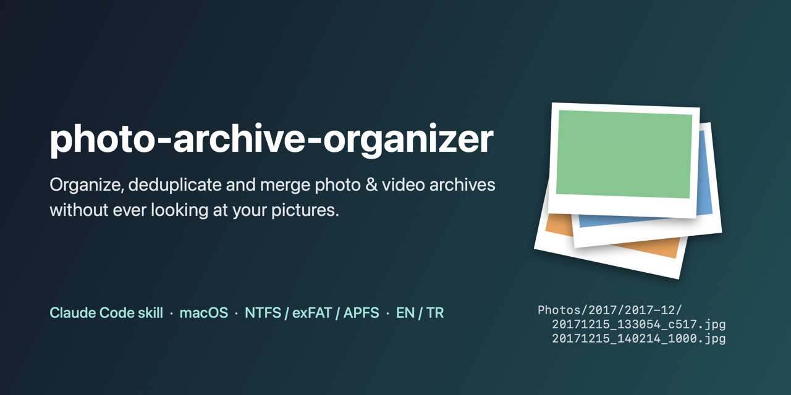

# photo-archive-organizer



[Türkçe](README.tr.md)

A [Claude Code](https://claude.com/claude-code) skill that safely organizes family
photo and video archives spread over external disks and local folders —
**without ever looking at your pictures**.

It was built while cleaning up a real family archive: several NTFS disks, old
phone and laptop dumps, backups of backups, rotated and WhatsApp copies, RAW+JPEG
pairs, broken JPEGs, two people's files mixed together. Everything it does is
logged and reversible.

## What it does

| Ask Claude… | What happens |
|---|---|
| "What's on the backup that's not in the archive? Pull it out." | Content comparison (SHA-256, names ignored), missing files moved/copied aside with their folders, counts that must add up |
| "Sort these into year/month folders." | `Photos/YYYY/YYYY-MM/YYYYMMDD_HHMMSS_ab12.jpg`, undated/screenshot/document handling, typed names kept, sidecars follow |
| "Find the near-duplicates." | Same pixels with other metadata, same capture moment, rotation-aware Apple Vision similarity, RAW with JPEG twin |
| "Merge this into the archive." | Same relative places, never overwrites, identical files reported |
| "Some JPEGs don't open." | Decode check, header rebuild from surviving image data |
| "Are my two backups the same?" | Path/size or full hash comparison |
| "Whose photos are these?" | Camera models × years × folders, you assign owners |

## Safety model

- **Privacy:** decisions come from hashes, EXIF and on-device Vision numbers.
  Pictures are never displayed, uploaded or described.
- **Plan → apply:** every changing command writes a plan you can read first.
- **No silent deletion:** extra copies go to `Duplicates/`, versions to `Similar/`;
  trashing needs your go-ahead, re-verifies every pair and uses the Finder Trash.
- **Logs:** each move/rename is written to `Logs/Operations-Log.csv` with hash
  and reason.
- **Counting:** `total = present + missing + skipped` is checked on every compare.
- **Across disks:** copy + verify; your source stays until you remove it.

## Requirements

- macOS (Linux/Windows: compare/standardize/merge work; Vision similarity,
  decode check and Finder trash are macOS-only)
- Python 3.8+ (preinstalled on macOS)
- [exiftool](https://exiftool.org)
- For Vision features: Xcode command line tools (`xcode-select --install`)

## Install

```bash
git clone https://github.com/oelbas/photo-archive-organizer ~/.claude/skills/photo-archive-organizer
sh ~/.claude/skills/photo-archive-organizer/tools/vision/build.sh      # optional, macOS
mkdir -p ~/.config/photo-archive-organizer
cp ~/.claude/skills/photo-archive-organizer/config.example.json ~/.config/photo-archive-organizer/config.json
```
Edit the config (language `en`/`tr`, albums to protect, device owners). Then just
talk to Claude Code about your photos.

## Command line (without Claude)

```bash
python3 scripts/pao.py env /Volumes/Backup --scan
python3 scripts/pao.py compare "/Volumes/Archive/Anna" "/Volumes/Backup/Anna-old"
python3 scripts/pao.py extract <plan.json> --dest "/Volumes/Backup/Anna-old-Missing" --apply
python3 scripts/pao.py standardize "/Volumes/Backup/Anna-old-Missing"
python3 scripts/pao.py apply <plan.json>
python3 scripts/pao.py similar "/Volumes/Backup/Anna-old-Missing" --reference "/Volumes/Archive/Anna"
python3 scripts/pao.py verify-aside "/Volumes/Backup/Anna-old-Missing"
python3 scripts/pao.py merge "/Volumes/Backup/Anna-old-Missing" "/Volumes/Archive/Anna"
python3 scripts/pao.py mirror-check "/Volumes/Archive/Anna" "/Volumes/Backup/Anna" --deep
```
`python3 scripts/pao.py <command> -h` explains each command.

## Layout

```
Anna/
  Photos/2017/2017-12/20171215_133054_c517.jpg
  Photos/2017/Screenshots/…
  Photos/2017/Undated/2017_07b4a3.jpg
  Photos/Undated/undated_e60e4e.jpg
  Videos/2011/2011-12/20111221_132538_3f3d.mod (+ .moi)
  Data/CV.pdf
  Logs/Operations-Log.csv
```
Turkish folder names with `"language": "tr"`: Foto, Video, Tarihsiz, Ekran
Goruntuleri, Data, Kayitlar, Cop, Benzerler, Bozuk.

## Tests

```bash
python3 -m unittest discover tests -v
```
The tests generate synthetic pictures (no real photos) and cover compare/extract,
standardize (layout, idempotency, Turkish names, albums), similarity (metadata-only,
EXIF, rotation-aware Vision, RAW policy), merge collisions and JPEG recovery.

## Limitations

- Vision similarity is unreliable on very small images (< 500 px); such matches
  are only listed.
- Undated rotated copies may not be recognised as versions.
- Video dates from QuickTime `CreateDate` are ambiguous (UTC vs. local);
  see `references/standard.md`.

## License

MIT — see [LICENSE](LICENSE).
